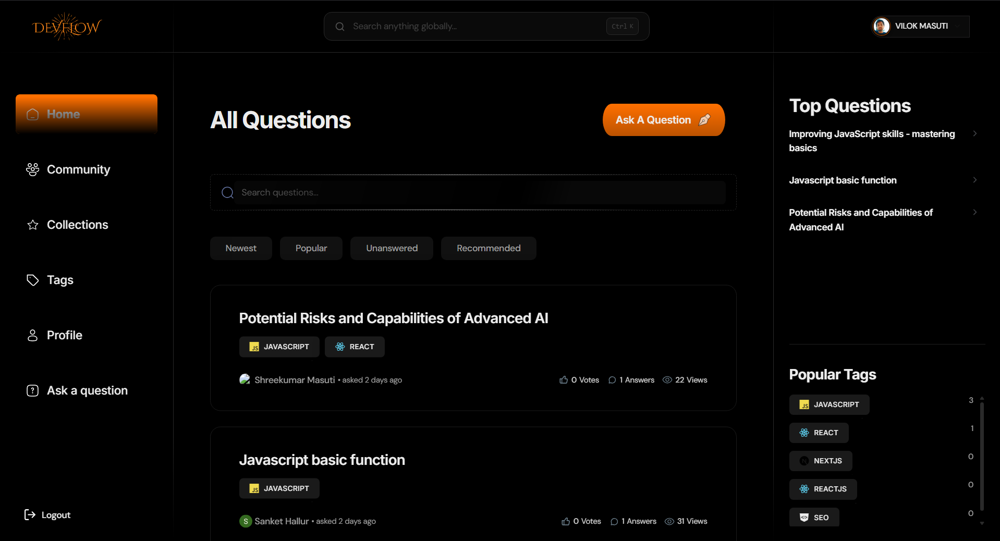
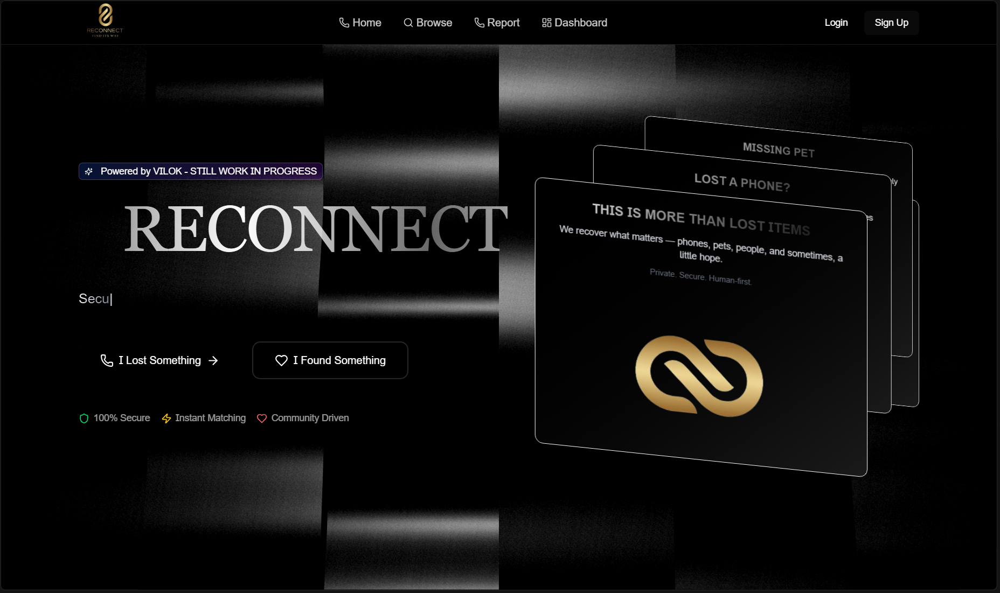

<table width="100%">
<tr>
<td valign="middle">

<a href="mailto:vilokmasuti@outlook.com" title="Email"><picture><source media="(prefers-color-scheme: dark)" srcset="https://cdn.simpleicons.org/maildotru/ffffff"></picture></a>
<b>Hey! I'm&nbsp;Vilok, a&nbsp;frontend&nbsp;engineer&nbsp;👋</b> 
I build fast, accessible web apps with React and Next.js. Took a production app from React to Next.js and pushed Lighthouse accessibility from 65 → 95. Open to frontend roles, anywhere.
</td>
</tr>
<tr>
<td align="center">

 

</td>
</tr>
<tr>
<td>
<b>languages</b> 

</td>
</tr>
<tr>
<td>
<b>frontend</b> 

</td>
</tr>
<tr>
<td>
<b>agents / ai</b> 

</td>
</tr>
<tr>
<td>
<b>infra</b> 

</td>
</tr>
</table>
