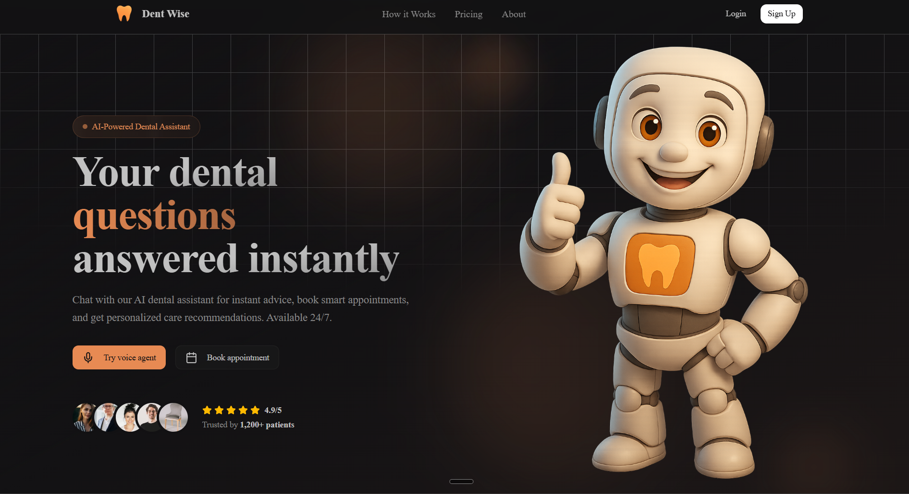

<b>V I L O K</b>

Frontend engineer · React · Next.js · TypeScript

<a href="https://www.linkedin.com/in/vilok-masuti-99aab8252">LinkedIn</a> &nbsp;·&nbsp;
<a href="mailto:vilokmasuti@outlook.com">Email</a>

 

 

**DevFlow** — Q&A platform for developers, with AI-assisted answers. &nbsp;[live](https://v-flow-alpha.vercel.app/) · [code](https://github.com/VilokMasuti/V-Flow)

**Dentwise** — dental practice SaaS with a real-time voice agent. &nbsp;[live](https://dental-ruby.vercel.app) · [code](https://github.com/VilokMasuti/Dental)

**Lost & Found** — mobile-first platform for recovering lost devices. &nbsp;[live](https://lost-found-livid.vercel.app) · [code](https://github.com/VilokMasuti/LostFound)

 

React · Next.js · TypeScript · Tailwind CSS · Framer Motion · TanStack Query · Zustand · Node.js · PostgreSQL · MongoDB · Supabase

  

Open to frontend roles, anywhere.
